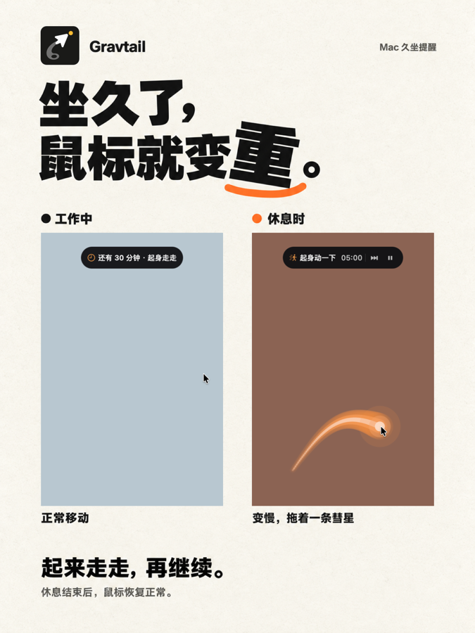
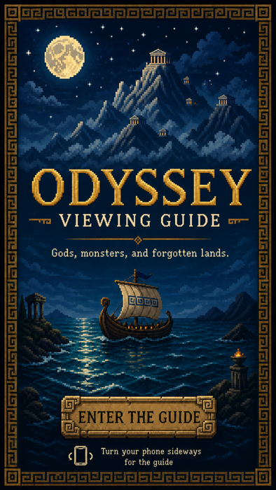
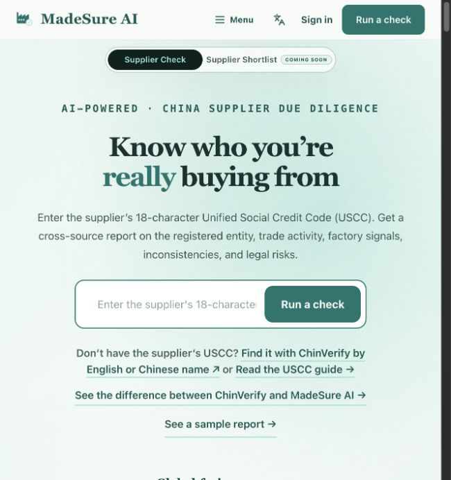

# About Me

> 我关注金融、产业与 AI 的交叉地带，希望把分散的信息、重复的研究工作和模糊的业务需求，转化为真正可用的产品。

我目前就读于中国人民大学应用经济学专业，此前在西南财经大学学习金融学。我的经历覆盖投资研究、AI 产品开发和企业 FDE 项目，也会开发一些解决个人需求的工具与互动作品。

## 01 · 个人工具与互动创作

这一部分收录的是我从自身需求或兴趣出发完成的独立项目，涵盖需求定义、产品设计、交互实现和测试迭代。

### [Gravtail｜工作状态与疲劳记录工具](https://github.com/AustinEudaimonia/Gravtail)

  

我在长期工作中发现，工作时长增加并不一定带来同比例的有效产出：随着疲劳积累，完成任务所需时间会逐渐增加，但这种变化通常只能依靠模糊感受判断。

基于这一观察，我独立开发了 Gravtail。它是一款 macOS 菜单栏工具，用于记录工作时长、任务完成情况和主观疲劳程度，并将这些信息转化为可视化趋势，帮助用户观察自己的精力变化和边际效率。

我独立完成了产品定义、交互逻辑、界面设计、功能开发和内部测试，并根据实际使用情况调整记录方式与展示结构。

[查看项目仓库](https://github.com/AustinEudaimonia/Gravtail)

### [《奥德赛》互动观影指南](https://github.com/AustinEudaimonia/odyssey-viewing-guide)

  

为了帮助没有阅读过《奥德赛》的观众快速理解其中复杂的人物、神祇、怪物和地点，我尝试将传统的长篇背景介绍改造成一个像素艺术风格的互动网页。

用户可以通过不同角色和地点进入故事，了解人物关系、神话背景及关键事件。项目重点不只是呈现资料，而是重新组织分散的信息，让用户能够以更直观、更轻松的方式进入《奥德赛》的世界。

我参与了内容结构、视觉方向、交互方式和网页实现。目前项目仍在继续完善，后续计划补充更完整的故事路径和在线体验。

[查看项目仓库](https://github.com/AustinEudaimonia/odyssey-viewing-guide)

## 02 · 企业交付

### 化妆品代理业务 FDE 项目

该项目面向一家化妆品代理商的实际业务流程。项目前期需要理解库存配货、订单核对、投标资料准备及内部信息查询等工作，识别其中依赖人工经验、资料分散和重复处理的问题。

我参与了管理层和一线代理商门店的需求访谈，整理企业已有资料与业务流程，并围绕库存匹配、订单核对、投标响应和知识检索等场景设计 AI 辅助方案。同时，我协助梳理交付边界、功能优先级和实际使用流程，为后续产品开发与 PoC 方向提供依据。

由于涉及企业内部业务信息，公开内容仅展示经过脱敏处理的项目背景、需求分析方法和方案框架，不包含客户名称、业务数据、内部资料或生产实现。

## 03 · AI 产品

### [MadeSure AI](https://madesureai.com)｜中国供应商尽调产品

  

MadeSure AI 是我与伙伴共同开发并已经公开上线的中国供应商尽调产品，主要服务希望在付款前核验中国供应商的海外采购者。

用户输入供应商营业执照上的统一社会信用代码后，系统会识别企业注册主体，检索并交叉整理企业登记、贸易、平台、法律及其他公开信息，最终形成带有信息来源、核实状态和证据边界的结构化报告。

在项目中，我主要负责供应商研究流程、企业主体识别、多源公开信息检索、证据抽取与交叉验证，以及研究结果向尽调报告的转化，并参与研究引擎、产品界面和部署测试。产品重点处理的不是简单的信息汇总，而是如何区分事实、推断和无法确认的信息，让使用者能够理解每项判断来自哪里。

[访问官网](https://madesureai.com)
